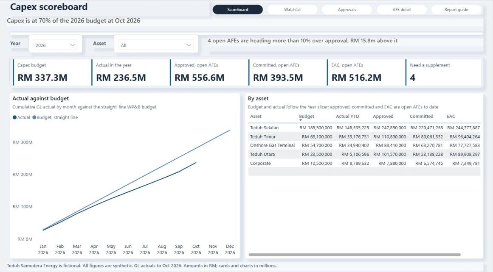

# Capex AFE desk: Power Apps, Power Automate and Fabric in one round trip

A capital project needs an approved AFE (authority for expenditure) before money is spent. A project engineer raises the
AFE in an app, with the estimate by cost element and by year. The finance controller checks it, then the approver the
limits of authority (LOA) name for its size decides in Approvals. Fabric brings in the purchase orders and GL actuals
each night, works out what each AFE has committed and will cost at completion (EAC), and sends that back to the app. When
an AFE heads more than 10% over its approval, the engineer raises a supplementary AFE from the flag.

**Teduh Samudera Energy is a fictional Malaysian upstream operator and all data is synthetic.** There is no live link:
the repository builds every part in your own tenant.

**Rebuild guide:** https://biventure2025.github.io/teduh-capex-afe-desk/docs/guide.html

## What it does

| Part | How |
|---|---|
| Raise an AFE | Canvas app, three steps: project, estimate by cost element and year, review. A supplement is one contingency line on an existing AFE |
| Approve | One cloud flow: finance controller check, then the LOA tier. T1 the asset's manager up to RM 5m, T2 GM Projects up to RM 25m, T3 the CEO above. The total counts the approved family, pending supplements and this request |
| Spend | A code app screen (React) reads the nightly status from Dataverse: approved, actual, committed, EAC, and a bar against the 110% line |
| Nightly | Pipeline: Copy job in (Dataverse to Lakehouse), ERP notebook, Gold notebook, Copy job out (Gold to Dataverse). A gate after each step stops the run unless the step's verdict ends in `_OK` |
| Report | Direct Lake model, 5 pages: Scoreboard, Watchlist, Approvals, AFE detail, Report guide |

## Results (read back from the build, 24 Nov 2026)

- Gold equals the frozen oracle on all 57 AFE families; 30 are open. Before the supplement loop 4 were heading more than 10% over approval.
- The supplement loop ran live: TSE-AFE-26-022 (RM 15.3m on TSE-AFE-26-009) went to the finance controller, then the CEO (T3, family total RM 81.5m). After both approvals and one pipeline run started from the DataFactory MCP, 26-009's approval reads RM 81.5m, its EAC is 100% of it, and 3 AFEs are flagged, in Dataverse, in the model and on the report.
- The LOA rule agrees in three places on 18 test amounts: the Python oracle, the app's Power Fx function, and the flow's own expressions.
- Copy job in: 640 rows read, 640 written. Copy job out: 57 status rows and 15 asset budget rows upserted.
- The report's totals match the ERP extract: GL actual RM 584,437,639.23, purchase orders RM 678,909,900.00.

## What is in the repository

| Folder | What is in it |
|---|---|
| `fabric/` | Lakehouse, three notebooks, the pipeline, the Direct Lake model and the report, in Fabric Git format |
| `dataverse/` | `dv_build.py`: publisher, solution, 8 tables and the seed rows by the Dataverse Web API |
| `flows/` | The approval flow's definition, its builder, its deploy script and the LOA vector test |
| `app/` | The canvas app as `.pa.yaml` and its generator; the theme tokens |
| `codeapp/` | The spend screen (React + TypeScript) and the build-and-push step |
| `src/`, `data/` | The data generator, the oracle, the Gold module with its offline test, and the builders of the estate, model and report |
| `kit/` | Helpers the builders use (PBIR primitives, `.pa.yaml` builders, the fabric-cicd deploy wrapper) |
| `solution/` | `sol_export.py`, which puts both apps in the solution and exports it |
| `docs/` | Rebuild guide, build record, brief, design package, mockup and next version |

## Licence

MIT. Built by Yeong Wai Son, Kuala Lumpur. Contact: waisonyeong@gmail.com
